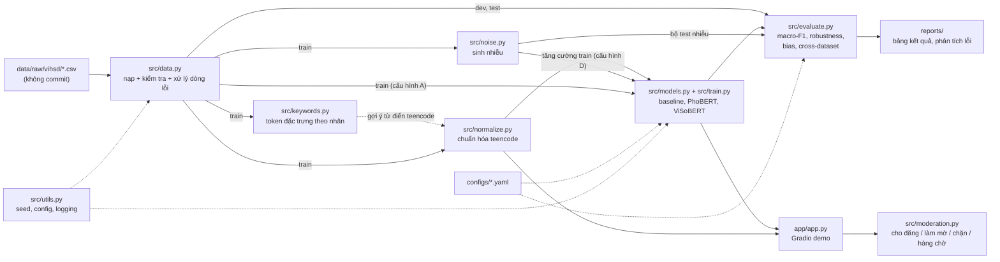

# Kiến trúc hệ thống

Tài liệu này mô tả hệ thống gồm những khối nào, dữ liệu chảy qua chúng ra sao, và mỗi khối đang ở trạng thái nào. Cập nhật khi thêm hoặc đổi một module. Lý do của từng lựa chọn nằm ở [decisions.md](decisions.md).

## 1. Luồng dữ liệu



Sơ đồ là **kế hoạch** đầy đủ. Khối nào đã có thật xem bảng ở mục 2.

## 2. Trạng thái từng module

| Module | Vai trò | Trạng thái | Test |
|---|---|---|---|
| `src/utils.py` | `set_seed`, `load_config`, `get_logger` | ✅ xong | `tests/test_utils.py` |
| `src/data.py` | nạp ViHSD, kiểm tra định dạng, xử lý dòng lỗi | ✅ xong | `tests/test_data.py` |
| `src/keywords.py` | token/bigram đặc trưng theo nhãn bằng log-odds | ✅ xong (kết quả: `data/README.md` mục 7) | `tests/test_keywords.py` |
| `src/normalize.py` | chuẩn hóa teencode, viết tắt, ký tự kéo dài/chèn | ⬜ tuần 3 | |
| `src/noise.py` | sinh nhiễu theo mức độ + seed | ⬜ tuần 4 | |
| `src/models.py`, `src/train.py` | baseline TF-IDF + LR (✅, kết quả: `reports/baseline_tfidf.md`); lưu/nạp mọi loại mô hình theo `type` (✅) | 🟡 | `tests/test_models.py` |
| `src/transformer.py` | fine-tune ViSoBERT (✅ chạy trên Kaggle, dev 0.709 một seed: `reports/transformer_visobert.md`); PhoBERT (⬜ phần 2c) | 🟡 | `tests/test_transformer.py` |
| `src/evaluate.py` | macro-F1, F1 từng lớp, confusion matrix, phần seen/unseen (✅); test nhiễu, bias, cross-dataset (⬜) | 🟡 | `tests/test_evaluate.py` |
| `src/moderation.py` | logic xử lý sau phân loại | ⬜ tuần 7 | |
| `app/app.py` | Gradio demo | ⬜ tuần 7 | |

## 3. Giao diện của các module đã có

### `src/data.py`

```
read_split(split, data_dir)   -> DataFrame   # đọc nguyên trạng + kiểm tra; sai thì ValueError
find_invalid_rows(df)         -> Series[bool] # True ở dòng rỗng / chỉ khoảng trắng / "#ERROR!"
clean_split(df, drop_invalid) -> DataFrame   # bản sao: bỏ dòng lỗi, hoặc thay text lỗi bằng ""
load_vihsd(split, data_dir)   -> DataFrame   # cửa vào chính = read_split + clean_split + log
```

- **Đầu ra** luôn có 2 cột `free_text` (chuỗi, không có NaN) và `label_id` (0 = CLEAN, 1 = OFFENSIVE, 2 = HATE).
- **Số dòng sau khi nạp** (đo ngày 08/10/2026): train 24036, dev 2672, test 6680.
- **Không làm:** không sửa nội dung bình luận (viết thường, bỏ dấu, teencode). Việc đó thuộc `normalize.py`.

### `src/keywords.py`

```
tokenize(text)                              -> list[str]          # NFC + viết thường, tách âm tiết, bỏ dấu câu/emoji
extract_ngrams(text, n)                     -> list[str]          # n âm tiết liền nhau
count_tokens_by_label(df, n)                -> dict[int, Counter] # số bình luận chứa n-gram, theo nhãn
log_odds_by_label(counts, prior_strength, min_count) -> DataFrame # label, token, count, count_rest, z
```

- **Đầu vào:** chỉ tập train từ `load_vihsd("train")`.
- **Tách token chỉ dùng cho phân tích**, không đưa vào mô hình (không mâu thuẫn D-005).

### `src/models.py`, `src/train.py`, `src/evaluate.py` (baseline)

```
build_tfidf_lr(features, model, seed) -> Pipeline      # TF-IDF word/char -> LogisticRegression
top_features(pipeline, label, k)      -> DataFrame     # trọng số lớn nhất mỗi nhãn, để kiểm tra mô hình học gì
compute_metrics(y_true, y_pred)       -> dict          # macro-F1, accuracy, P/R/F1 từng lớp, confusion matrix
find_seen(texts, train_texts)         -> Series[bool]  # câu đã gặp trong train (so sau NFC + viết thường + gộp khoảng trắng)
python -m src.train --config configs/X.yaml            # fit train, đo train + dev + "luôn đoán CLEAN"
                                                       #   -> models/X.joblib (không commit), reports/X/dev_metrics.json
python -m src.evaluate --config configs/X.yaml --split test   # chỉ chạy 1 lần -> reports/X/test_metrics.json
```

- Mỗi lần chạy được xác định hoàn toàn bởi một file trong `configs/`; báo cáo lưu lại cả nội dung config và phiên bản scikit-learn.
- `train.py` **không bao giờ** đọc test; chỉ `evaluate.py --split test` làm việc đó, và in cảnh báo.
- `evaluate.py` đọc thêm train, nhưng chỉ để biết câu nào đã gặp; file chỉ số có 3 phần: toàn bộ, `seen_in_train`, `unseen_in_train` (D-014).

### `src/transformer.py` (tuần 2, D-015, D-016)

```
config: type: transformer  ->  train.py gọi train_transformer(config, train, dev, checkpoints_dir)
train_transformer(...)            -> TransformerClassifier   # Trainer: đo dev mỗi epoch, giữ epoch macro-F1 dev cao nhất
TransformerClassifier.predict_proba(texts) -> ndarray (n, 3) # cùng giao diện với Pipeline scikit-learn
TransformerClassifier.save(dir) / .load(dir)                # models/<tên>/ (không commit)
compute_class_weights(labels)     -> list[float]             # "balanced", giống scikit-learn
python -m src.transformer --config configs/X.yaml           # phân bố số token trên TRAIN để chọn max_length
```

- `save_model` / `load_model` trong `models.py` chọn cách lưu theo `type`, nên `evaluate.py` không cần biết loại mô hình.
- Nhiều seed (D-019): `with_seed(config, seed)` trong `utils.py` tạo tên `<tên>_s<seed>`; `train` và `evaluate` nhận `--seed`. `summarize_seeds` trong `evaluate.py` gộp các báo cáo thành `reports/<tên>/<split>_summary.json` (trung bình ± độ lệch chuẩn mẫu). Checkpoint bị xóa sau khi train, chỉ giữ mô hình epoch tốt nhất.
- Cần transformers 4.x (D-016). Huấn luyện thật chạy trên Kaggle theo `docs/kaggle.md`; test trên máy dùng một mô hình BERT tí hon tự tạo, không tải gì từ mạng.

## 4. Ranh giới dữ liệu (chống rò rỉ)

| Việc | Được dùng | Không được dùng |
|---|---|---|
| Xây từ điển teencode, thống kê từ khóa | train | dev, test |
| Sinh nhiễu để tăng cường (cấu hình D) | train | dev, test |
| Chọn siêu tham số, chọn mô hình | dev | test |
| Chọn epoch tốt nhất của transformer | dev | test |
| Chọn `max_length` | train (phân bố số token) | dev, test |
| Tạo bộ test nhiễu | test (chỉ để đánh giá) | |
| Báo cáo kết quả cuối | test, chạy một lần | |

Mọi module mới phải ghi rõ nó dùng tập nào, và test phải kiểm tra được điều đó nếu khả thi.
